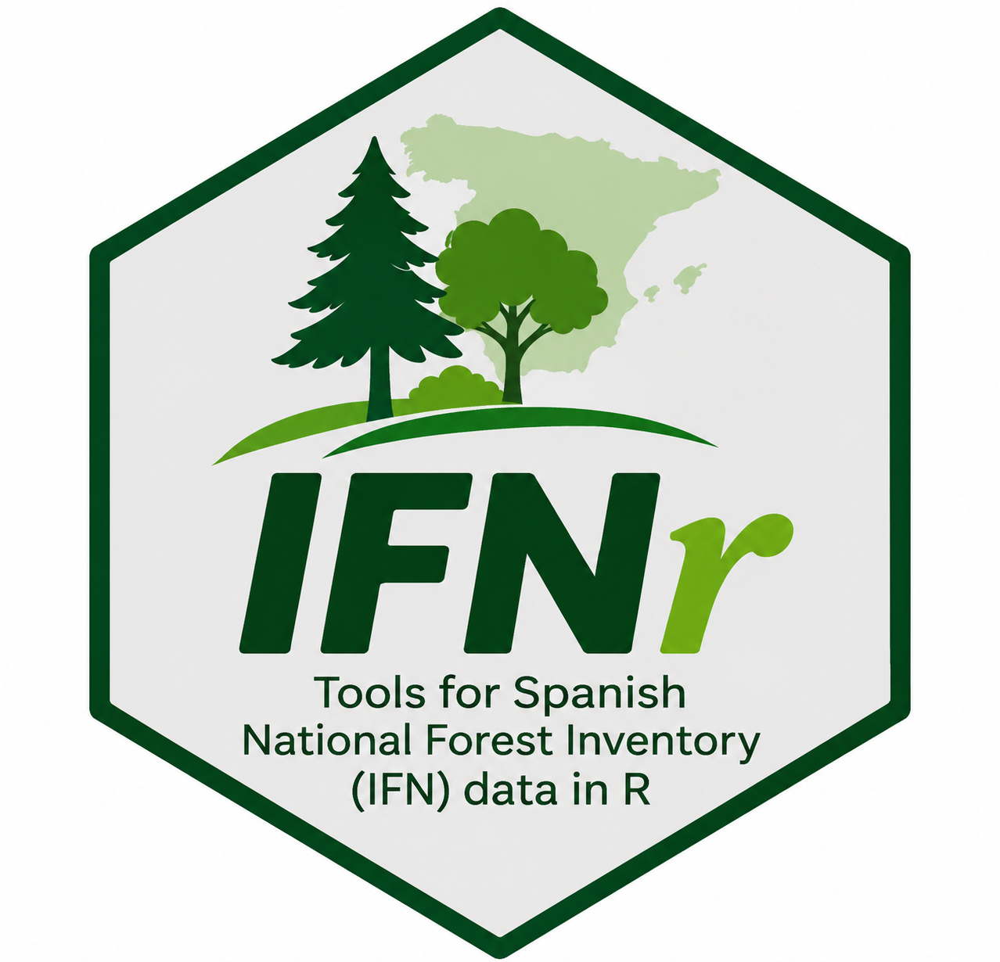

# IFNr 

<!-- badges: start -->

<!-- badges: end -->

## Overview

**IFNr** is an R package designed to process and analyse data from the
Spanish National Forest Inventory (*Inventario Forestal Nacional*, IFN).

The package provides tools to calculate forest stand attributes, analyse
the relative importance and dominance of tree species, and estimate tree
biomass using allometric equations.

Main functionalities include:

- Calculation of forest stand attributes: basal area, tree density, mean
  diameter and mean height.
- Assessment of species importance based on basal area or tree density.
- Identification of dominant and main tree species at plot level.
- Estimation of tree biomass using allometric equations.

## Installation

Install the development version of **IFNr** from GitHub:

``` r
# install.packages("devtools")
devtools::install_github("ameztegui/IFNr")
```

## Datasets

The package includes three example datasets:

| Dataset | Description | Main use |
|----|----|----|
| `IFN3_example` | Example data from the third Spanish National Forest Inventory (IFN3). | Stand attributes and species importance |
| `IFN4_example` | Example data from the fourth Spanish National Forest Inventory (IFN4). | Stand attributes and species importance |
| `inventory` | Tree-level inventory data derived from IFN4. | Allometric biomass calculations |

Load the package and datasets with:

``` r
library(IFNr)

data("IFN3_example")
data("IFN4_example")
data("inventory")
```

## Forest stand attributes

IFNr includes four functions to calculate basic forest stand attributes:

- `get_BA()`: basal area.
- `get_N()`: tree density.
- `get_diam()`: mean diameter at breast height, weighted by tree
  density.
- `get_hei()`: mean tree height, weighted by tree density.

Calculations can be performed at plot level, by diameter class, by
species, or by combining both grouping criteria. Geographic filters can
also be applied using province or autonomous community.

### Examples

Calculate basal area per plot:

``` r
get_BA(
  IFN = "IFN4",
  df = IFN4_example
)
```

Calculate tree density by species:

``` r
get_N(
  IFN = "IFN4",
  df = IFN4_example,
  per_species = TRUE
)
```

Calculate mean diameter by diameter class:

``` r
get_diam(
  IFN = "IFN3",
  df = IFN3_example,
  per_CD = TRUE
)
```

Calculate mean tree height by species:

``` r
get_hei(
  IFN = "IFN3",
  df = IFN3_example,
  per_species = TRUE
)
```

## Species importance and dominance

IFNr provides two functions to analyse the relative importance of tree
species within forest inventory plots. Species importance can be
calculated using basal area (`criterion = "BA"`) or tree density
(`criterion = "N"`).

### `get_dominant_sps()`

Identifies plots where a given species reaches or exceeds a specified
percentage of total basal area or tree density.

For example, identify plots where *Pinus sylvestris* accounts for at
least 50% of basal area:

``` r
get_dominant_sps(
  df = IFN4_example,
  species = "Pinus sylvestris",
  criterion = "BA",
  threshold = 50
)
```

### `get_main_sps()`

Identifies the main species in each plot according to their relative
importance.

You can specify the number of species to retain (`n_species`), a minimum
importance threshold (`threshold`), or both. Species not meeting the
selection criteria are grouped into an `"Other"` category.

For example, retain the three most important species based on basal
area:

``` r
get_main_sps(
  df = IFN4_example,
  criterion = "BA",
  n_species = 3
)
```

Alternatively, retain species accounting for at least 10% of total basal
area:

``` r
get_main_sps(
  df = IFN4_example,
  criterion = "BA",
  threshold = 10
)
```

## Allometric equations

The `calculate_allom()` function estimates tree biomass using allometric
equations. The package includes different equation systems, including
RUIZ, INIA and IEFC_2.

The function uses tree diameter and, depending on the equation system,
may also use tree height. The `frac` argument controls whether biomass
fractions or total aboveground biomass are returned.

For example, calculate biomass fractions using the INIA equations:

``` r
calculate_allom(
    df = inventory,
    variable = "BAT",
    equation = "INIA",
    sps = Sps_name,
    dbh = "Dn",
    frac = TRUE
    )
```

See `?calculate_allom` for details on the available equation systems,
input requirements and returned variables.

## Citation

If you use **IFNr** in your research, please cite the package with:

``` r
citation("IFNr")
```

## License

IFNr is released under the MIT License.

## Author

**Aitor Ameztegui**

GitHub: <https://github.com/ameztegui/IFNr>
